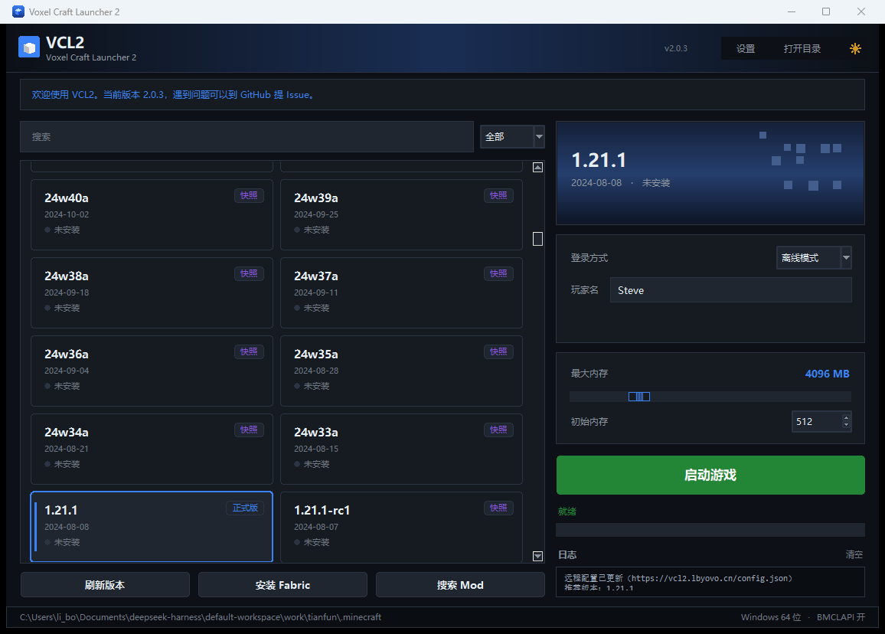
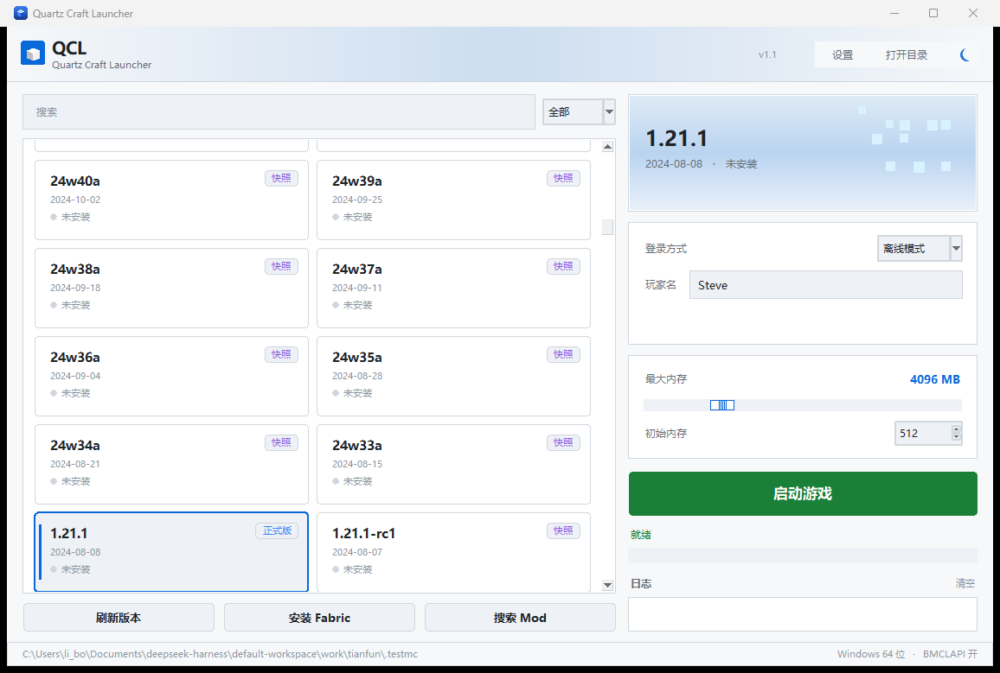
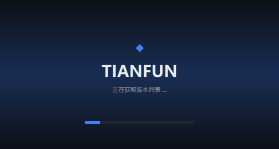

# VCL2 — Voxel Craft Launcher 2

[](https://github.com/liboyang-ovo/VCL2/actions/workflows/build.yml)

纯 Python 实现的 Minecraft Java 版启动器，**零第三方依赖**（图形界面用标准库 tkinter），
支持 Windows 7 / 8 / 10 / 11 与 Linux / macOS。

图标由 `assets/make_icon.py` 用 Pillow 程序化生成（超采样抗锯齿，输出 PNG + 多尺寸 ICO），
改配色或形状后重新跑一次即可，不需要外部设计文件。

| 深色主题 | 浅色主题 |
|---|---|
|  |  |

启动动画：



## 下载

- **免安装版**：到 [Releases](https://github.com/liboyang-ovo/VCL2/releases) 下 `VCL2.exe`，
  单文件，Windows 7 / 10 / 11 都能跑（打 tag 时由 GitHub Actions 自动构建）
- **源码运行**：`python main.py`（需要 Python 3.8+，无第三方依赖）

## 环境要求

| 项 | 要求 | 说明 |
|---|---|---|
| Python | **3.8+** | Windows 7 最高只能装 Python 3.8，本项目按 3.8 语法编写 |
| 依赖 | **无** | 不需要 pip 安装任何东西，tkinter 随 Python 自带 |
| 系统 | Win7 SP1 及以上 | Win7 需先装 KB2533623 与 VC++ 2015-2019 运行库（Python 3.8 的要求） |

> 2.0 起已移除 PySide6：它只支持 Windows 10+，在 Win7 上根本装不上。

## 两种模式

### 图形界面

```bash
python main.py
```

左侧选版本，右侧填玩家名和内存，点「启动游戏」。首次启动会自动下载客户端、库、资源与 Java。

### 命令行模式（无 GUI 依赖，可在 SSH / 无桌面环境跑）

```bash
python main.py --help                       # 查看全部命令
python main.py list                         # 列出所有版本（* = 已安装）
python main.py list --filter release --limit 10
python main.py install 1.21.1
python main.py launch 1.21.1 --name Steve --ram 4096
python main.py launch 1.21.1 --detach       # 启动后立即返回
python main.py fabric list 1.21.1
python main.py fabric install 1.21.1 --loader 0.16.9
python main.py mod search 小地图
python main.py mod install 1.21.1 小地图
python main.py java check
python main.py config show
python main.py config set max_ram 4096
```

通用参数（放在子命令之后均可）：

```
--dir PATH                  指定 .minecraft 目录
--mirror official|bmclapi   下载源（国内建议 bmclapi）
--config FILE               指定配置文件
--quiet                     安静模式
```

`list` / `fabric list` / `mod search` 支持 `--json`，方便脚本处理。

## 功能

- **双主题**：深色 / 浅色，设置里切换，或点顶栏 ☀ / ☾ 一键换肤（不重启）
- **两列网格版本卡片**：圆角卡片、悬停高亮、选中描边、类型徽章、安装状态
- **启动动画**：无边框渐变启动页，淡入淡出，最少显示 0.9 秒
- **封面**：右侧渐变封面 + 程序生成的像素方块装饰，随选中版本变化
- 版本清单拉取与缓存，一键安装（客户端 / 库 / natives / 资源 / 日志配置）
- Java 自动检测，或自动下载官方 JRE（Windows / macOS / Linux）
- 微软账户 OAuth2 登录（浏览器自动抓授权码 + 手动粘贴兜底）
- 离线模式（按名字生成稳定 UUID）
- Fabric 加载器安装（自动合并原版依赖）
- Mod 搜索（MC 百科）与 Modrinth 下载安装
- 国内镜像（BMCLAPI），失败自动回退官方源
- 并发下载、断点续传、SHA1 校验

## 目录结构

```
main.py                      入口：无参数开 GUI，带子命令走 CLI
minecraft_launcher/
├── gui_tk.py                tkinter 界面（替代原 gui.py）
├── cli.py                   命令行模式
├── config.py                配置读写
├── constants.py             常量与下载地址
├── version.py               版本清单 / 版本 JSON / 安装
├── libraries.py             库与 natives 处理、规则判断
├── java.py                  Java 检测与安装
├── auth.py                  微软 OAuth2 / 离线身份
├── ms_login.py              浏览器窗口标题抓授权码
├── modloader.py             Fabric 安装
├── mcmod.py                 MC 百科搜索 + Modrinth
├── game_launcher.py         启动参数构建与进程管理
├── remote_config.py         远程配置（公告 / 推荐版本 / 更新检查）
├── sysinfo.py               系统位数探测（32 位适配）
└── network/downloader.py    下载器（并发 / 续传 / 镜像）
tests/smoke_test.py          离线冒烟测试
```

## 2.0 的变化

相比 1.x（PySide2 那版）：

- 界面用 tkinter 重写，不再依赖 PySide，Win7 也能跑
- 加了命令行模式，安装、启动、装 Fabric、搜 Mod 都能在终端做
- 32 位系统做了适配：内存自动限制到 1024 MB，1.17+ 会提示跑不了
- 改成便携模式，配置和游戏数据跟程序放在一起
- 修了 Fabric 启动缺 classpath、分辨率被强改、os.arch 规则失效等几个问题

## 测试

```bash
python tests/smoke_test.py
```

覆盖规则判断、离线 UUID、配置读写、启动参数构建（含占位符替换与分辨率开关），
共 32 项，全部离线运行。

## 便携模式（绿色版）

默认所有数据都放在**程序目录**，整个文件夹拷走就能换机器：

```
VCL2/
├── VCL2.exe           启动器
├── .minecraft/        游戏数据（versions / assets / libraries）
└── .vcl2/              启动器配置、微软 token、远程配置缓存
```

- 程序目录不可写时（例如装在 `Program Files`），自动退回用户目录：
  配置 `~/.vcl2`、游戏数据 `%APPDATA%\.minecraft`
- 从旧版本升级时，会**自动把 `~/.vcl2/launcher.json` 拷到程序目录**，不用重新配置
- 想强制指定位置：设置环境变量 `VCL2_HOME`，或用 `--config` 参数

## 已知限制

- 微软登录靠浏览器窗口标题抓授权码，无标题栏的浏览器可能抓不到，可手动粘贴 `code=`
- Windows 7 上 Python 3.8 已停止官方支持，遇到 TLS 问题建议升级系统
- Mod 搜索依赖 MC 百科页面结构，站点改版可能导致解析失效

## 说明

- 本启动器不包含任何游戏本体资源，所有文件均从 Mojang 官方服务器下载
- 离线模式仅用于单机 / 局域网，请尊重正版
- 启动器数据（配置、token）默认保存在 `~/.minecraft-launcher/`

## 协议

MIT
